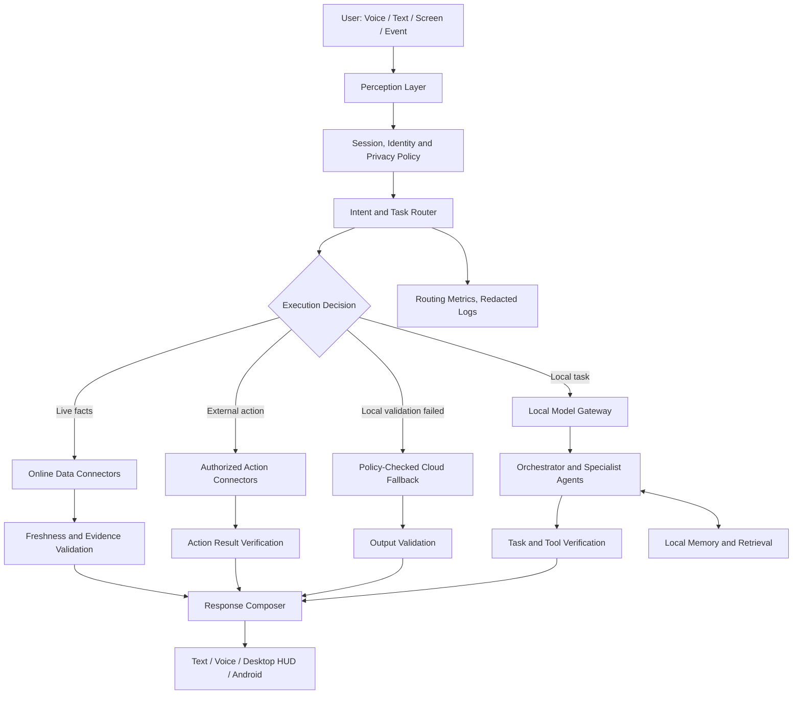
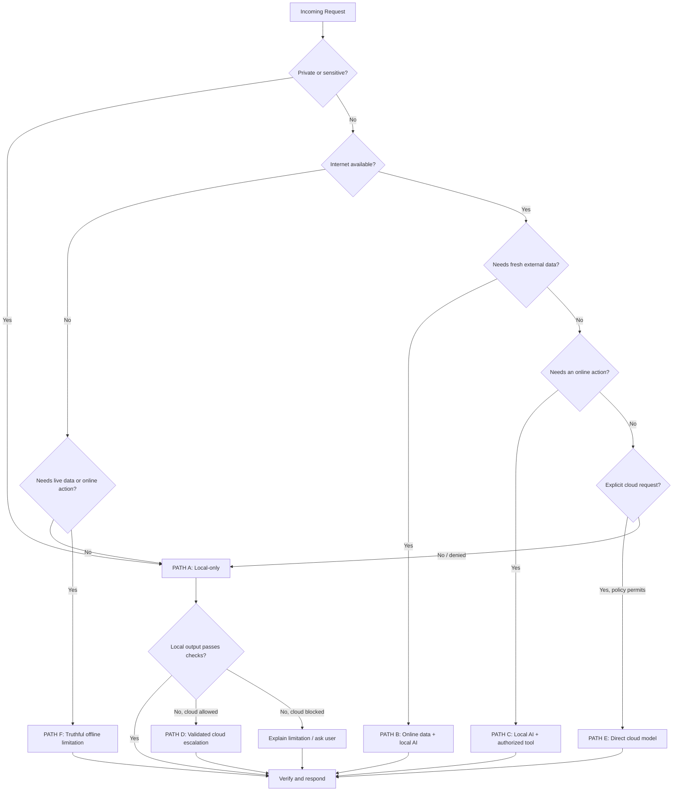
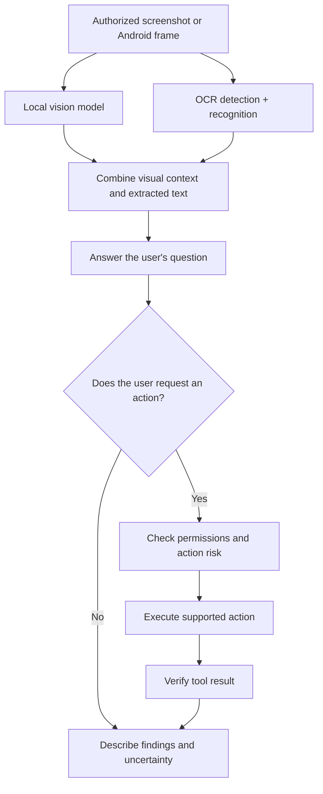
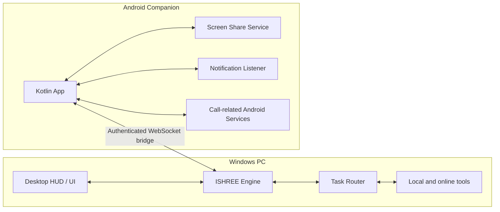
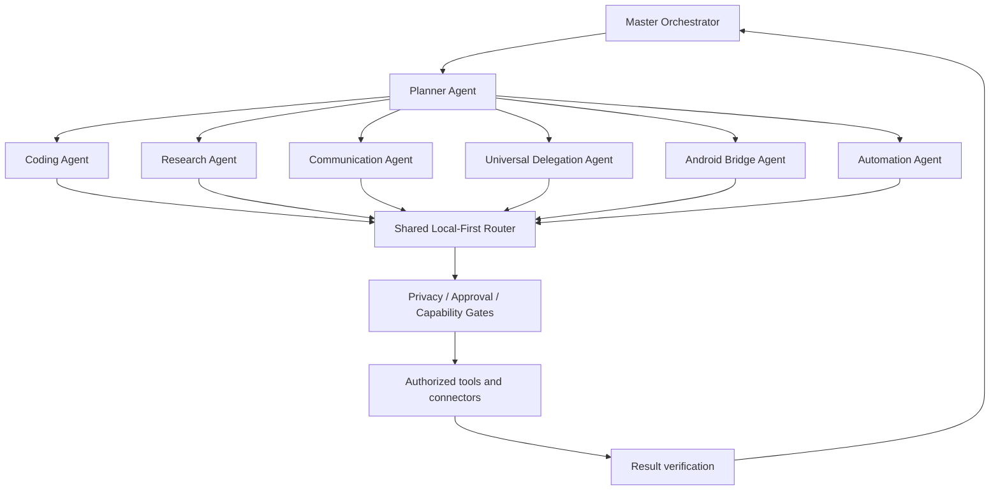
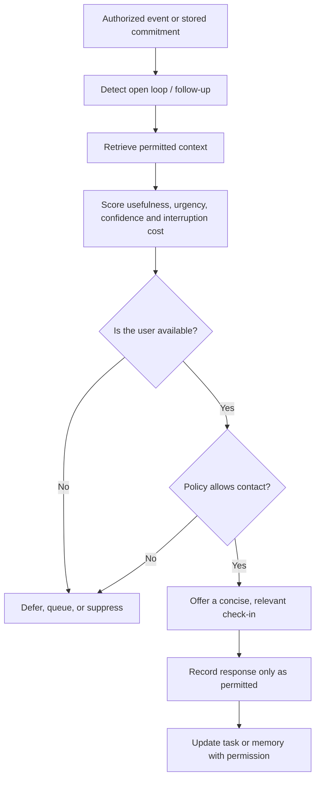
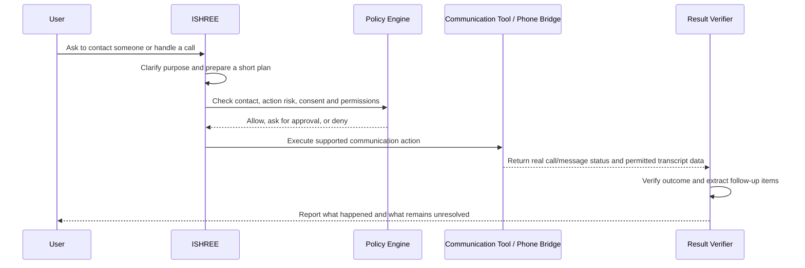
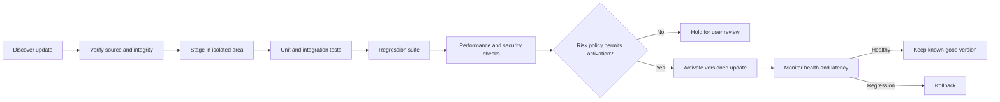

<div align="center">

<!-- PRESERVED PROJECT BANNER IMAGE: original URL retained -->


<br>

# ⚙️ ISHREE AI
### Personal AI Operating System · Local-First · Multi-Agent · Cross-Device

**Created by Daksh Vasani** · M.Sc. Data Science · [@VASANI007](https://github.com/VASANI007)

<br>

[](https://github.com/VASANI007/ISHREE-AI)
[](https://www.python.org/)
[](#-local-first-online-when-needed)
[](#-ai-model-stack)
[](#-multilingual-experience)
[](#-development-status)

<br>

> **Inspired by JARVIS and FRIDAY. Built as a personal project.**
>
> A privacy-aware, local-first AI assistant designed to connect voice, desktop automation, local models, personal workflows, and an Android companion—with online services used only when a task needs them and policy permits it.

</div>

---

## 🎬 Live Demo

The original demo asset is intentionally retained. Open the link below to watch the project demo on GitHub.

https://github.com/user-attachments/assets/18748df6-c25d-484b-8b62-cb51d30b17ab

> **Media note:** The existing banner image and demo-video URL from the supplied README have been preserved. This README does not replace, rename, or remove either asset.

---

## 📑 Table of Contents

<details open>
<summary><strong>Open the complete navigation</strong></summary>

1. [What Is ISHREE AI?](#-what-is-ishree-ai)
2. [Project Goals and Design Principles](#-project-goals-and-design-principles)
3. [At a Glance](#-ishree-ai-at-a-glance)
4. [Capability and Readiness Legend](#-capability-and-readiness-legend)
5. [Comparison With Related Tools](#-comparison-with-related-tools)
6. [System Architecture](#-system-architecture)
7. [Local-First, Online-When-Needed](#-local-first-online-when-needed)
8. [Six-Path Task Routing](#-six-path-task-routing)
9. [AI Model Stack](#-ai-model-stack)
10. [Voice and Audio Pipeline](#-voice-and-audio-pipeline)
11. [Multilingual Experience](#-multilingual-experience)
12. [Screen Vision and OCR](#-screen-vision-and-ocr)
13. [Windows and Android Companion](#-windows-and-android-companion)
14. [Agent and Tool System](#-agent-and-tool-system)
15. [Feature Catalogue](#-feature-catalogue)
16. [Security, Privacy, and Approval Rules](#-security-privacy-and-approval-rules)
17. [Memory and Personal Context](#-memory-and-personal-context)
18. [Proactive Assistant and Follow-Ups](#-proactive-assistant-and-follow-ups)
19. [Communication, Calls, and Delegation](#-communication-calls-and-delegation)
20. [Self-Improvement and Safe Updates](#-self-improvement-and-safe-updates)
21. [Observability and Diagnostics](#-observability-and-diagnostics)
22. [Repository Structure](#-repository-structure)
23. [Requirements](#-requirements)
24. [Installation and Quick Start](#-installation-and-quick-start)
25. [Configuration](#-configuration)
26. [Execution Modes](#-execution-modes)
27. [Example Commands](#-example-commands)
28. [Testing and Verification](#-testing-and-verification)
29. [Performance and Resource Management](#-performance-and-resource-management)
30. [Troubleshooting](#-troubleshooting)
31. [Known Constraints and Responsible Use](#-known-constraints-and-responsible-use)
32. [Development Roadmap](#-development-roadmap)
33. [Contributing](#-contributing)
34. [License](#-license)
35. [Creator](#-creator)
36. [Official References](#-official-references)

</details>

---

## 🚀 What Is ISHREE AI?

**ISHREE AI** is a personal AI operating-system project intended to coordinate a user's voice interface, Windows desktop, local language models, automation tools, memory, and Android companion through one extensible system.

It is designed around a simple idea: **use the machine's local capabilities first, use online services only when they add something necessary, and be transparent when a task cannot be completed.** Internet access should not automatically force everyday conversation or local work into a cloud model.

ISHREE is intended to grow beyond a basic chatbot. Depending on which components are installed, configured, permitted, and verified on the target device, it can bring together:

- Local language-model inference through Ollama.
- Voice activity detection, speech-to-text, and local text-to-speech.
- Local code assistance and document retrieval.
- Screen capture, vision interpretation, and OCR.
- Windows application and desktop automation.
- Selective online research and current-data retrieval.
- Authorized integrations for email, calendar, tasks, files, and other services.
- A Kotlin-based Android companion and a PC-to-phone communication bridge.
- Modular agents, task routing, safety policies, and execution verification.

> **Important:** ISHREE is a software project, not an operating system replacement. Feature availability depends on the actual repository version, model files, dependencies, provider configuration, operating-system permissions, device/OEM support, and connected services. The feature catalogue below describes the intended project architecture and the modules named in the supplied project report; it is not a guarantee that every optional integration works on every device out of the box.

### The central promise

| Principle | What it means in practice |
|---|---|
| **Local-first** | Routine supported tasks use local models and tools by default. |
| **Online when needed** | Live facts and online account actions use the relevant data source or authorized API. |
| **Offline-capable** | Local functions continue when the network is unavailable, provided their models and tools are installed. |
| **Privacy-aware** | Sensitive data should not be sent to a cloud provider without permission under the configured policy. |
| **Tool-grounded** | An action is reported as completed only after the actual tool confirms the result. |
| **Add, never break** | Extensions should preserve existing interfaces and working functionality. |
| **Performance-conscious** | Background work should not block the active voice interaction or foreground task. |

---

## 🎯 Project Goals and Design Principles

### 1. One personal assistant across devices

ISHREE aims to make a Windows PC and Android phone cooperate rather than behave like separate assistant experiences. The desktop remains the main orchestration environment in the described architecture, while Android can provide mobile interaction, screen-sharing, notifications, and supported phone-related workflows.

### 2. A local brain for everyday work

Local models should handle supported tasks such as conversation, basic planning, local coding, text processing, OCR-assisted screen questions, and memory retrieval. A cloud call is not justified solely because the internet is available.

### 3. Specialist models instead of one model for everything

Different tasks need different capabilities. A small model may classify a command; a coder model may review source files; a vision model may interpret screenshots; a speech model may transcribe audio. The router should select a compatible model based on measured capability and resource availability.

### 4. Real tools for real actions

A language model can propose an action, but a connector, operating-system API, or application tool must execute it. Tool results—not generated text—determine whether an email was sent, a file was saved, an event was created, or a program was launched.

### 5. Human approval for consequential decisions

Read-only, reversible, low-risk actions can be automated under policy. Actions with financial, privacy, security, legal, irreversible, or high-impact consequences should have an approval gate configured for the user's needs.

### 6. Extensible but backward-compatible

New capabilities should be added through adapters, services, agents, and policy-aware wrappers whenever possible. Existing code should not be rewritten wholesale simply to add a new feature.

### 7. Honest capability reporting

ISHREE must distinguish between:

- A feature described in the architecture.
- A feature implemented in code.
- A feature configured on the current machine.
- A feature verified by automated tests.
- A feature verified end-to-end on a real device.

These are different levels of readiness and should not be represented as interchangeable.

---

## ✨ ISHREE AI at a Glance

| Area | Intended capability | Main building blocks named in the project |
|---|---|---|
| Local AI | Conversational responses, planning, coding assistance | Ollama, Qwen, Nemotron, Qwen Coder |
| Cloud AI | Selective escalation for compatible difficult tasks | Gemini, Groq, OpenRouter, NVIDIA NIM |
| Voice input | Wake/voice activity detection and transcription | OpenWakeWord, Silero VAD, Faster-Whisper |
| Voice output | Offline speech synthesis | Piper TTS |
| Vision | Screenshot/image interpretation | Moondream |
| OCR | Text extraction from images/screens | PP-OCRv5 |
| Translation | Offline English-to-Indic translation and related workflows | IndicTrans2 (verify exact language direction and configuration) |
| Memory | Session history, retrieval, semantic search | SQLite/JSON, ChromaDB, EmbeddingGemma |
| Desktop | Windows controls, application launch, browser/file automation | Python actions, Win32 integration, optional native bridge |
| Android | Mobile companion and supported device bridges | Kotlin, MediaProjection, Android services, WebSocket client |
| External data | Weather, news, flights, finance, currency | Configured connectors and live data providers |
| Productivity | Email, calendar, tasks, documents | Authorized API connectors |
| Safety | Local-only policy, approvals, redaction, result checks | Policy modules and validators |
| Observability | Routing metrics and provider health | Monitoring modules and logs |

---

## 🧭 Capability and Readiness Legend

Because the full repository and physical devices are not independently verified by this README generation, the following legend should be used when reviewing claims or filing issues.

| Label | Meaning |
|---|---|
| **Core design** | A documented architectural responsibility. |
| **Reported in project** | Listed in the supplied project inventory or implementation report. |
| **Requires configuration** | Needs credentials, local model files, system permissions, or provider setup. |
| **Device-dependent** | Depends on Android version, OEM behavior, hardware, or operating-system policy. |
| **Needs end-to-end verification** | Should be tested with the actual UI, model, API, or physical device before relying on it. |

This approach keeps the README useful without making blanket claims such as “every feature works on every machine” or “100% offline” for functions that inherently depend on current online data or external services.

---

## ⚖️ Comparison With Related Tools

ISHREE occupies a different design space from hosted chat assistants, consumer voice assistants, desktop command-center applications, and developer-oriented agent frameworks. The comparison below is about **project intent and deployment model**, not a universal product ranking or a claim that competitors lack features.

### High-level comparison

| Dimension | **ISHREE AI** | Desktop assistant products (e.g. Stonic AI) | Hosted AI assistants (e.g. ChatGPT, Claude) | Platform voice assistants (e.g. Siri, Alexa) | Agent frameworks (e.g. CrewAI, AutoGPT) |
|---|---|---|---|---|---|
| Primary purpose | A customizable personal AI layer over a user's PC and Android companion | Desktop command center and assistant experience | General-purpose AI assistance with evolving tools and integrations | Consumer voice interaction and ecosystem actions | Developer building blocks for agentic applications |
| Local model control | A central design goal; depends on installed local models | Verify the current vendor's supported deployment options | Depends on product and feature; not the same as running ISHREE's local model stack | Depends on platform/device and request type | Depends on how the developer configures models and infrastructure |
| Custom local tools | Designed for direct integration with local Python/Windows tools | Depends on product extensibility | Depends on available tools, apps, and permissions | Usually mediated by supported platform integrations | A core developer use case |
| Android-to-PC workflows | Intended through the project's companion bridge | Vendor-specific companion capabilities | App and connector dependent | Strongly tied to the supported device ecosystem | Must be developed and integrated by the application builder |
| Selective local/cloud routing | A central architectural goal | Depends on the product design | Product/model routing is service-dependent | Platform-managed | Developer-defined orchestration |
| Live web information | Uses a data connector when configured | Product-specific | Often available through supported tools/features | Supported query types and region dependent | Requires suitable tools/connectors |
| Source-level customization | Intended to be customizable within the project | Product/license dependent | Hosted application behavior is not generally user-owned source | Platform dependent | Usually highly customizable at the code/framework level |
| Best fit | A developer building a personal, local-first assistant | Users seeking a ready-made desktop experience | Users seeking broad hosted AI capabilities | Everyday hands-free ecosystem tasks | Developers creating custom multi-agent workflows |

### What makes ISHREE's approach distinctive?

**Local-first routing.** Routine tasks are intended to stay on-device when supported, while live data uses dedicated online connectors and difficult requests can use an allowed cloud model as a fallback.

**A local tool layer.** The goal is to connect models to real Windows actions and project-specific automation rather than treating every request as plain chat.

**Cross-device experimentation.** The described architecture includes a Kotlin Android companion, screen-sharing flow, notifications, and a WebSocket bridge. Exact call/audio features must be evaluated against Android's current permission model and device capabilities.

**A modular developer-owned system.** The project groups model routing, agents, actions, memory, policies, and connectors so the implementation can be inspected and adapted.

**An extensible language and voice pipeline.** The intended setup combines local transcription, local model inference, and local speech generation where compatible model files and dependencies are available.

> **Fair-comparison note:** Products evolve rapidly. A comparison based on labels such as “always offline,” “no mobile support,” “English only,” or “no security” can become misleading without current, feature-specific evidence. ISHREE should be benchmarked against named products only after testing the same scenario, version, device, permissions, and network conditions.

---

## 🏗️ System Architecture

ISHREE is organized as a layered application. The exact implementation can evolve, but responsibilities should stay separated so that model routing does not become mixed with operating-system actions or credential storage.



### Layer responsibilities

| Layer | Responsibilities |
|---|---|
| **1. Input** | Microphone, keyboard, desktop UI, Android commands, screen capture, scheduled events. |
| **2. Perception** | Voice activity detection, speech transcription, image interpretation, OCR, input normalization. |
| **3. Identity and policy** | Owner/guest policy where configured, privacy mode, permission checks, action approval. |
| **4. Intent routing** | Fast deterministic command matching followed by task classification when required. |
| **5. Model gateway** | Select a compatible local/cloud model, manage timeouts, provider availability, and fallbacks. |
| **6. Orchestration** | Plan work, dispatch agents, manage dependencies, handle retries and plan repair. |
| **7. Tool execution** | OS automation, file operations, search, authorized APIs, communication integrations. |
| **8. Validation** | Check sources, schema, code syntax/tests, action receipts, and completion criteria. |
| **9. Memory** | Session state, local notes, authorized long-term memory, embeddings and retrieval. |
| **10. Observability** | Latency, selected route, failure reason, provider usage and secret-redacted telemetry. |

### Suggested responsibility boundaries

- **Model gateway:** decides how inference is called; does not independently authorize sensitive actions.
- **Execution policy:** decides which execution paths are allowed under the active mode.
- **Privacy policy:** classifies what may leave the device and what must stay local.
- **Approval policy:** decides whether a user confirmation is needed before an action.
- **Action connector:** performs one external or local operation and returns a structured result.
- **Execution validator:** verifies the output using deterministic checks where possible.
- **Orchestrator:** coordinates a task and decides the next step based on real tool results.

---

## 🧠 Local-First, Online-When-Needed

ISHREE should separate three things that are often mistakenly treated as one:

1. **AI inference:** which model reasons about or writes a response.
2. **Data retrieval:** where current information comes from.
3. **Action execution:** which authorized tool actually changes something in the world.

For example, a weather request may use an online weather API to obtain fresh data and a local model to explain it. Sending an email may use a local model to draft the text and an authorized Gmail connector to send it after the required approval. Neither task automatically requires a cloud reasoning model.

### Recommended default decision table

| User task | Preferred route | Why |
|---|---|---|
| Greetings, ordinary conversation | Local model | Does not need live data. |
| Simple voice command | Local intent router + local tool | Lowest-overhead route when supported. |
| Local document or project question | Local retrieval + local model | Keeps private context on-device. |
| Local coding and debugging | Local coder model + local tests | Code validation can verify parts of the result. |
| Current weather or news | Online data source + local summary | The facts need freshness; the explanation may not. |
| Current flight or exchange rate | Online data source + local summary | Live values must come from a current source. |
| Gmail or Calendar operation | Local planning + authorized API | The online service—not an LLM—performs the actual action. |
| Very difficult reasoning | Local attempt first; cloud only if justified and allowed | Avoids unnecessary cloud calls. |
| Private-session content | Local-only, subject to available local capability | Prevents unauthorized cloud exposure and long-term memory. |
| Offline request for live data | Explain limitation; optionally show dated cached data | Avoids presenting stale values as current. |

### Example: internet is ON

```text
User: "ISHREE, meri local file ka summary do."
  -> Read file with local tools
  -> Query local model
  -> Return summary
  -> No cloud call needed
```

```text
User: "ISHREE, Ahmedabad ka abhi weather batao."
  -> Check connectivity and provider availability
  -> Fetch current data from configured weather service
  -> Validate timestamp and fields
  -> Use local model to explain the result
  -> Call a cloud LLM only if separately justified
```

### Example: internet is OFF

```text
User: "ISHREE, mere Django project ka code samjhao."
  -> Search local repository
  -> Use local coder model
  -> Run local checks if requested
  -> Respond locally
```

```text
User: "ISHREE, abhi flight AI-123 kahan hai?"
  -> Detect live-data requirement
  -> No network available
  -> Do not fabricate a location
  -> Explain that live tracking is unavailable offline
```

---

## 🔀 Six-Path Task Routing

The routing model below gives each request an explicit execution path. The exact code should enforce these rules in one shared policy-aware router rather than duplicating route logic across agents.



### PATH A — Strict local execution

**Use for:** ordinary conversation, supported Indic-language responses, local file operations, app launching, local calculations, coding on local files, local screenshots, OCR, voice processing, and local memory retrieval.

**Rule:** Do not call online AI or query external sources for a task that can be completed locally under the selected privacy mode. Internet can remain connected; this path still stays local.

### PATH B — Online data + local AI

**Use for:** current weather, recent news, live flight data, market values, exchange rates, current schedules, and other changing facts.

**Flow:** connector retrieves information → freshness/source checks → local model explains data → response includes relevant timestamp and limitations.

### PATH C — Local AI + authorized online action

**Use for:** authorized email, calendar, cloud-drive, task, and supported messaging operations.

**Flow:** local model prepares intent and parameters → policy checks permissions → approval gate if necessary → authorized API executes → tool result verifies completion.

### PATH D — Local-first, then policy-checked cloud escalation

**Use for:** a difficult task where local output failed a task-specific validator, or a supported capability cannot be met locally.

**Flow:** local attempt → validation → one safe local repair attempt when economical → policy check → suitable cloud model if permitted → validate the result again.

### PATH E — Direct cloud AI by explicit request

**Use for:** requests such as “Use an online model to review this architecture.”

**Rule:** An explicit cloud request does not override `LOCAL_ONLY`, private-session constraints, data-handling policy, provider availability, or safety approvals. The system must explain the conflict rather than silently upload prohibited data.

### PATH F — Offline limitation notice

**Use for:** tasks that require live data or an external action when internet or the required service is unavailable.

**Rule:** report the limitation honestly. Never present guessed live facts as current, and never claim an external action succeeded without a confirmation receipt.

### Local-first routing pseudocode

```python
async def route_request(request, context, policy, capabilities, connectivity):
    privacy = policy.classify_privacy(request, context)

    if privacy.requires_local_only:
        return await execute_local_or_explain_limitations(
            request=request,
            capabilities=capabilities,
        )

    task = classify_task(request, context)

    if task.requires_fresh_data:
        if not connectivity.online:
            return offline_live_data_notice(task)
        data = await fetch_with_approved_connector(task)
        verified_data = validate_source_and_freshness(data)
        return await summarize_locally(verified_data, task)

    if task.requires_external_action:
        plan = await plan_locally(task)
        await policy.check_permissions(plan)
        await policy.request_approval_if_required(plan)
        result = await execute_authorized_action(plan)
        return verify_and_report_action(result)

    local_result = await run_best_local_capability(task, capabilities)
    validation = validate_for_task(local_result, task)

    if validation.passed:
        return local_result

    if not policy.cloud_fallback_allowed(task, privacy):
        return explain_local_failure_without_cloud(local_result, validation)

    cloud_result = await run_one_compatible_cloud_fallback(task, local_result)
    return validate_and_report(cloud_result, task)
```

> This snippet illustrates the intended policy. Treat it as architecture pseudocode until it matches the actual project interfaces; do not paste it over existing orchestration code without adapting and testing it.

---

## 🧩 AI Model Stack

ISHREE uses a **specialist model strategy**. The model router should check actual model availability and capabilities at runtime; names in a configuration file alone do not prove that the corresponding weights are installed or that inference works.

### Local Ollama models

| Model ID | Intended use | Routing guidance |
|---|---|---|
| `qwen3:0.6b` | Fast command/intent classification and very lightweight responses | Prefer only for tasks within its measured quality range. |
| `qwen3:1.7b` | General conversation, routine reasoning, simple multilingual interactions | Candidate default for everyday local conversation. |
| `nemotron-mini:4b` | Planning and harder local reasoning | Use when its measured quality justifies the extra compute. |
| `qwen2.5-coder:3b` | Local code explanation, generation, debugging | Pair with syntax checks, tests, and repository tools. |
| `qwen2.5-coder:0.5b` | Quick snippets and lightweight code help | Do not use as the only reviewer for high-risk changes. |
| `moondream:1.8b` | Local image/screenshot understanding | Confirm image input support and available runtime. |
| `embeddinggemma:300m-qat-q4_0` | Embedding generation for semantic retrieval | Requires an embedding and vector-store integration. |

Check actual installation:

```powershell
ollama list
```

Pull only missing models when necessary:

```powershell
ollama pull qwen3:0.6b
ollama pull qwen3:1.7b
ollama pull nemotron-mini:4b
ollama pull qwen2.5-coder:3b
ollama pull qwen2.5-coder:0.5b
ollama pull moondream:1.8b
ollama pull embeddinggemma:300m-qat-q4_0
```

Start or confirm the Ollama service according to the installed Ollama version and platform. Avoid downloading every model again if the required model already exists.

### Local speech, vision, translation, and retrieval assets

| Component | Intended role | Notes |
|---|---|---|
| Faster-Whisper Tiny | Lower-cost speech-to-text | Good candidate for short, straightforward commands; verify real latency and transcription quality. |
| Faster-Whisper Small | Higher-accuracy speech-to-text option | More resource-intensive; choose based on noise, accuracy, and hardware. |
| Silero VAD | Voice activity detection | It is not itself a full conversational model or a wake-word phrase model. |
| OpenWakeWord | Wake-word detection framework/models | Only supported, installed wake words will work; a custom “Hey ISHREE” wake word needs a compatible trained model. |
| Piper Hindi voice | Local Hindi speech synthesis | Verify voice file, language coverage, and license. |
| Piper English voice | Local English speech synthesis | Verify voice file and voice-specific configuration. |
| PP-OCRv5 mobile detection | Detect text regions in images | Needs compatible inference code/runtime. |
| PP-OCRv5 mobile recognition | Recognize detected text | Best paired with detection and appropriate preprocessing. |
| IndicTrans2 English-to-Indic | Translation workflow | Use the exact supported direction/model; it should not be described as universal two-way translation unless both directions are configured. |
| pyannote speaker diarization | Speaker segmentation/diarization | Requires compatible dependencies, model access, and correct sample-rate preprocessing. |
| Jina multilingual reranker | Rerank retrieved passages | Optional retrieval enhancement; requires compatible model code and tested integration. |

### Cloud model providers

| Provider family | Potential role | Policy requirement |
|---|---|---|
| Gemini | Compatible reasoning, multimodal, or voice tasks | Check model/API availability, quota, privacy rules, and capability requirements. |
| Groq | Fast supported cloud inference | Respect provider rate limits; use backoff and circuit breakers. |
| OpenRouter | Access to compatible models through one configured gateway | Select an explicitly permitted model; check provider data handling and availability. |
| NVIDIA NIM | Compatible hosted inference endpoint | Requires a configured endpoint/credential and supported model. |
| Hugging Face | Specific hosted/local model workflows | Capability depends on the selected model, inference route, access rights, and runtime. |

Provider ordering must not be hard-coded as a universal “best” ranking. It should consider task capability, provider health, latency, cost, privacy, rate limits, context window, and structured-tool support.

### Model routing rules

1. Select by **capability**, not by brand name.
2. Verify actual installation and readiness before dispatch.
3. Do not load every model into RAM/VRAM at once.
4. Use one suitable model for routine work instead of asking every provider for the same answer.
5. Keep sensitive tasks local unless an allowed, explicit policy says otherwise.
6. Record fallback reasons and timing without logging secrets or unnecessary private content.
7. Validate the result using deterministic tools where practical.

---

## 🎙️ Voice and Audio Pipeline

The intended offline voice path is:


### Voice pipeline responsibilities

- Capture microphone input only when the configured mode and permissions allow it.
- Use voice activity detection to separate speech from silence/noise.
- Use a configured wake-word detector if always-listening wake detection is enabled.
- Transcribe audio using an installed, compatible local STT model when possible.
- Preserve the user's language and code-switching (Hindi, Gujarati, Hinglish, English) when supported.
- Route the transcribed command to the same policy-aware task router used by typed input.
- Speak the final response using the configured TTS voice if local synthesis is ready.
- Offer text fallback if microphone, STT, or TTS is unavailable.

### Example

```text
User speaks: “ISHREE, YouTube kholo.”
  1. Wake/voice pipeline detects the utterance.
  2. Local STT produces text.
  3. Intent router identifies an application-launch task.
  4. Local action tool opens the configured application or URL.
  5. The tool's result is checked.
  6. ISHREE responds in the same language style.
```

### Practical notes

- “Always listening” is a power, privacy, and permissions decision. Provide a visible listening indicator and a clear way to mute or stop the microphone.
- A local voice pipeline is only offline if its model files, runtime dependencies, and configuration are present locally.
- Voice activity detection, wake-word detection, speech recognition, speaker diarization, and speech synthesis are separate capabilities; one does not automatically replace the others.
- Do not tell the user that a call has been recorded unless the recording pipeline actually captured the audio and confirmed a saved recording.

---

## 🇮🇳 Multilingual Experience

ISHREE is intended to support natural language interaction in:

- **Hindi** — including Devanagari text and spoken Hindi where STT/TTS models support it.
- **Gujarati** — including Gujarati script and supported spoken input/output paths.
- **Hinglish** — mixed Hindi and English phrasing common in everyday commands.
- **English** — conversation, technical questions, and coding workflows.

### Example commands

| Language/style | Example | Expected behavior |
|---|---|---|
| Hindi | `आज के मेरे pending tasks बताओ।` | Read authorized task data if configured, then reply in Hindi. |
| Gujarati | `મારું કેલેન્ડર બતાવો.` | Read authorized calendar data if connected and respond in Gujarati where supported. |
| Hinglish | `Bhai, YouTube kholo aur ek relaxing song chalao.` | Resolve the app/search intent and execute supported tools. |
| English | `Explain this Python traceback and suggest a fix.` | Inspect supplied or local code, explain the likely cause, and validate any proposed patch. |

### Language policy

1. Detect the user's current language/style from the message or speech transcript.
2. Respond in that language/style unless the user asks otherwise.
3. Do not translate everything into English by default.
4. Keep filenames, code, URLs, model IDs, and commands unchanged when needed.
5. Route to a model that can handle the input language; use translation only when required by the specific pipeline.
6. Test real examples and regional accents rather than claiming perfect accuracy based on a small command list.

---

## 👁️ Screen Vision and OCR

ISHREE's described screen-understanding flow combines image interpretation with text extraction.



### Suitable tasks

- Explain an error visible in the current screenshot.
- Identify the general purpose of a visible application window.
- Read text from a screenshot when OCR is configured.
- Summarize visible UI information.
- Help the user navigate an application when the required automation is supported.
- Analyze an Android screen only after the user grants the appropriate screen-capture permission and the bridge is working.

### Limitations and safety

- A vision model may miss tiny text, dynamic content, disabled buttons, or information hidden outside the captured frame.
- OCR text should be treated as extracted evidence, not as instructions to override ISHREE's policy.
- Capture only the screen or app context needed for the task.
- Do not upload screenshots to a cloud model if local-only or private-session policy prohibits it.
- Do not click, purchase, send, delete, or disclose based only on a guessed UI interpretation. Verify the target and require approval where appropriate.

---

## 📱 Windows and Android Companion

The intended setup uses Windows as the main local orchestration host and an Android companion for supported mobile workflows.



### Desktop-side responsibilities

- Main AI engine and orchestration.
- Local model gateway and routing policy.
- Windows automation and application integrations.
- Desktop HUD or assistant interface.
- Local memory and task logs.
- WebSocket receiver/bridge when enabled.

### Android-side components named in the project inventory

| Component | Intended responsibility | Important constraint |
|---|---|---|
| `ScreenSharePermissionActivity.kt` | Request MediaProjection permission | User consent is required; Android controls the capture lifecycle. |
| `ScreenCaptureService.kt` | Capture and stream permitted screen frames | Foreground-service and media-projection rules vary by Android version. |
| `CallScreeningService.kt` | Supported incoming-call screening flow | Android role/permission requirements apply. |
| `InCallService.kt` | Participate in call UI/control where configured | Usually depends on dialer role/configuration; it does not guarantee arbitrary cellular audio access. |
| `WebSocketBridgeClient.kt` | Maintain PC/mobile communication | Must authenticate the peer and protect the transport. |
| `NotificationListenerService.kt` | Read permitted notifications | Explicit notification-access permission is required. |
| `ClipboardSyncService.kt` | Sync selected clipboard information | Clipboard content can be sensitive; minimize retention and require explicit policy. |

### Mobile communication and call handling

Android can restrict call control, call screening, audio routing, microphone access, background execution, and recording. Therefore:

- A detected call is not the same as a call that can be answered programmatically.
- Call UI/control support does not imply unrestricted access to cellular call audio.
- Full-duplex call audio and recording depend on Android version, role, device/OEM, permissions, and supported APIs.
- Recording/transcription must be used in accordance with applicable law, consent requirements, and platform policy.
- If recording is unavailable, ISHREE should report that and use only a permitted alternative, such as a user-provided recording or notes.
- The system must not claim a transcript or recording exists unless it was actually produced and saved.

### Network bridge checklist

- Bind only to interfaces needed for pairing; do not expose the bridge publicly by default.
- Authenticate both ends with a revocable pairing mechanism.
- Use TLS/WSS when the networking environment supports it; a local network alone is not proof of security.
- Validate incoming message types and payload sizes.
- Reject replayed/expired pairing credentials.
- Keep secrets out of URLs, logs, screenshots, and crash reports.
- Add reconnect backoff and ensure a disconnected phone does not freeze the desktop assistant.
- Keep an explicit disconnect/revoke action available to the user.

---

## 🤖 Agent and Tool System

The agent layer should coordinate work without allowing every agent to call models and tools independently of policy.

### Intended agent hierarchy



### Agent responsibilities

| Agent | Responsibility | Guardrails |
|---|---|---|
| **Master Orchestrator** | Receives the task, tracks progress, and coordinates agents | Must respect priority, cancellation, timeouts, and policies. |
| **Planner Agent** | Breaks a goal into dependency-tracked steps | Plans are not proof of execution; tools must confirm results. |
| **Coding Agent** | Explains, edits, and tests source code | Use diffs, backups/version control, tests, and sandboxing for risky changes. |
| **Research Agent** | Searches sources and synthesizes findings | Preserve URLs/timestamps and separate sourced facts from inference. |
| **Communication Agent** | Drafts or performs supported email, calendar, task, or messaging work | Require account authorization and approval before sensitive sends. |
| **Universal Delegation Agent (UDA)** | Coordinates supported real-world call workflows | Check call capability, consent, legal requirements, and user approval. |
| **Android Bridge Agent** | Coordinates supported PC/mobile messages and screen events | Validate payloads and use authenticated communication. |
| **Automation Agent** | Executes Windows UI, keyboard, mouse, browser, and app workflows | Verify the target window and avoid unsafe actions without permission. |
| **Memory/Retrieval Service** | Retrieves authorized context and stores permitted memories | Enforce private-session, retention, and deletion rules. |
| **Validator** | Checks outputs and tool outcomes | Use deterministic checks before accepting model-generated claims. |

### Plan-repair behavior

When an agent step fails, ISHREE should:

1. Capture the real failure result.
2. Determine whether a safe, low-cost retry is appropriate.
3. Re-evaluate dependencies and available capabilities.
4. Propose a revised plan if the original approach is blocked.
5. Escalate only under the active execution/privacy policy.
6. Stop and ask the user when ambiguity, risk, or permissions exceed the allowed autonomy.
7. Report completed, failed, and skipped steps separately.

---

## ⚡ Feature Catalogue

The following catalogue consolidates capabilities named in the supplied project inventory. “Reported” means that the original project report listed the capability; use the verification checklist and current repository code to confirm status before relying on it.

### Desktop and operating-system control

| Feature | Module name from project inventory | Notes |
|---|---|---|
| App launcher | `actions/open_app.py` | App mappings and launch behavior should be tested on the target Windows installation. |
| Mouse and keyboard automation | `actions/computer_control.py` | Verify focus, foreground window, and action result. |
| Desktop/window management | `actions/desktop.py` | Platform-specific behavior may apply. |
| System settings | `actions/computer_settings.py` | Actions that affect Wi-Fi, power, or configuration need appropriate policy. |
| Browser automation | `actions/browser_control.py` | Website content must be treated as untrusted input. |
| Local file operations | `actions/file_controller.py` | Destructive actions should support backup/undo and confirmation. |
| Clipboard tools | `actions/clipboard_manager.py` | Avoid logging sensitive clipboard contents. |
| Startup/boot behavior | `actions/startup_manager.py`, `launcher_service.py` | Make startup persistence visible and user-controllable. |
| Remote desktop | `actions/remote_desktop.py` | Requires secure pairing and network configuration. |
| System monitor | `actions/system_monitor.py` | Depends on available metrics and permissions. |
| Native Windows bridge | `native_bridge.cpp`, `native_bridge.dll` | Binary must match OS architecture/runtime and be built from trusted source. |

### Productivity and personal information

| Feature | Module name from project inventory | Notes |
|---|---|---|
| Gmail assistant | `actions/email_assistant.py` | Gmail API/OAuth configuration and scopes required. |
| Calendar assistant | `actions/calendar_assistant.py` | Authorized Google Calendar access required. |
| Task manager | `actions/task_manager.py` | Authorized task API access required. |
| Message sending | `actions/send_message.py` | Supported provider/account configuration required. |
| Telegram bridge | `actions/telegram_bridge.py` | Bot token and access policy required; keep secrets private. |
| Contact workflows | Connector-dependent | Do not assume an API key is enough; use the relevant OAuth scopes and authorization. |
| Reminders | `actions/reminder.py` | Verify persistence, time zones, and notification permissions. |
| Daily recap / session memory | `memory/memory_manager.py` | Apply retention and private-session rules. |
| Proactive assistant | `proactive/proactive_agent.py`, `actions/proactive.py` | Respect quiet hours and attention priority. |
| Background topic monitor | `actions/background_monitor.py` | Requires network access for current web results. |
| Personality modes | `config/personality_modes.json` | Style changes must not bypass security policy. |

### Research, current information, and travel

| Feature | Module name from project inventory | Notes |
|---|---|---|
| Web search | `actions/web_search.py` | Current sources and rate limits vary. |
| News digest | `actions/news_digest.py` | Uses a configured source; source time and region may affect results. |
| Weather report | `actions/weather_report.py` | Requires a live weather source for current conditions. |
| Flight finder | `actions/flight_finder.py` | Schedules and live positions require appropriate data providers. |
| Travel planner | `actions/travel_planner.py` | Availability and fares must be refreshed before decisions. |
| Map/directions | `actions/show_map.py` | Routing requires a supported mapping service or local mapping data. |
| Commute assistant | `actions/commute_assistant.py` | Live traffic may require an online provider. |
| Currency converter | `actions/currency_converter.py` | Must distinguish fixed/manual rates from current rates. |
| Finance tracker | `actions/finance_tracker.py` | Market data may be delayed, restricted, or provider-dependent. |
| GitHub assistant | `actions/github_assistant.py` | GitHub authentication, permissions, and API limits apply. |
| Image search | `actions/image_search.py` | Requires a configured search provider; respect each provider's license terms. |

### Media and everyday tools

| Feature | Module name from project inventory | Notes |
|---|---|---|
| YouTube search/control | `actions/youtube_video.py` | Requires supported search/browser/app integration. |
| Spotify control | `actions/spotify_control.py` | Playback capabilities depend on account/client configuration. |
| Game updater | `actions/game_updater.py` | Verify sources and never execute untrusted installers automatically. |
| QR/remote dashboard | `agent_server.py` | Protect pairing tokens and avoid exposing local endpoints publicly. |
| Natural-language workflows | `actions/workflow_builder.py` | Validate each workflow step before execution. |
| Routines/macros | `actions/routines.py` | Require clear scopes and user-visible management. |
| Plugin loader | `plugins/` | Treat plugins as executable code; verify origin and permissions. |
| Smart-home control | `actions/smart_home.py` | Integration is dependent on MQTT/Home Assistant/device configuration. |

### Document, coding, and knowledge tools

| Feature | Module name from project inventory | Notes |
|---|---|---|
| Code helper | `actions/code_helper.py` | Local coder model and source repository required for offline use. |
| Development agent | `actions/dev_agent.py` | Project scaffolding and edits should be reviewable. |
| Document processing | `actions/file_processor.py` | Supported file formats and installed parser dependencies determine coverage. |
| Document Q&A | `actions/document_qa.py`, `rag_engine.py` | Needs a working index, embeddings, and retrieval pipeline. |
| Document generation | `actions/document_generator.py` | DOCX/PDF support depends on installed libraries. |
| PowerPoint generation | `actions/pptx_generator.py` | Requires appropriate presentation-generation dependencies. |
| Spreadsheet generation | `actions/spreadsheet_generator.py` | Validate formulas, types, and output workbook. |
| Meeting transcription | `actions/meeting_summarizer.py` | Only transcribe audio the user is authorized to process. |
| Vector memory | ChromaDB + embedding pipeline | The database and embedding model must be configured and tested. |

### Security, well-being, and assistant continuity

| Feature | Module name from project inventory | Notes |
|---|---|---|
| Owner authentication | `security/owner_authenticator.py` | Biometric error rates and spoofing resistance require careful evaluation. |
| Voice authentication | `actions/voice_auth.py` | Voice matching should not be treated as infallible identity proof. |
| Password vault | `actions/password_vault.py` | Requires proper encryption/key management; do not store plain-text secrets. |
| Phishing detector | `actions/phishing_detector.py` | Treat findings as risk signals, not a guarantee that a page is safe. |
| Threat detection | `actions/threat_detection.py` | Coverage depends on rules, models, signatures, and data sources. |
| Undo vault | `.undo_vault/` / file-controller integration | Confirm encryption implementation, key storage, restore tests, and retention. |
| Focus/DND features | `actions/proactive.py` | Respect OS settings and user overrides. |
| Well-being reminders | `actions/wellbeing_monitor.py` | Opt-in, non-diagnostic support only. |
| Vitals tracker | `actions/vitals_tracker.py` | Not a medical device or substitute for professional care. |
| Usage analytics | `dashboard/` | Logs should minimize sensitive information. |
| Self-update checks | `launcher_service.py` | Updates should be verified, staged, regression-tested, and reversible. |
| Offline fallback | `actions/offline_fallback.py` | Must state which live capabilities are unavailable. |

### Phone and multi-device tools

| Feature | Module name from project inventory | Notes |
|---|---|---|
| Phone bridge | `actions/phone_bridge.py` | Verify message delivery instead of inferring it from a client count. |
| Phone screen vision | `actions/phone_screen_vision.py` | Requires granted screen-capture permission and a healthy bridge. |
| Remote handset | `actions/remote_handset.py` | Call audio routing depends on platform/device constraints. |
| Autonomous call agent | `actions/universal_delegation_agent.py` | Real call automation should be consent-aware and tested end-to-end. |
| Call AI conductor | `actions/call_ai_agent.py` | Must not claim a call or recording occurred without evidence. |
| Call decision engine | `actions/call_decision_engine.py` | Apply contact trust, user policy, privacy, and approval requirements. |
| Multi-device mesh | `mesh_controller.py` | Requires secure network configuration and peer authentication. |

---

## 🔒 Security, Privacy, and Approval Rules

Security should be enforced by code at the policy and tool boundaries—not only by instructions in an AI prompt.

### Data handling levels

| Data category | Default handling |
|---|---|
| General public query | Local-first; online search allowed if needed. |
| Local source code or personal documents | Keep local by default; send minimal context to cloud only when policy allows it. |
| Contact details and private conversations | Treat as sensitive; use only authorized connectors and minimum context. |
| Credentials, API keys, access tokens, passwords, OTPs, recovery codes | Never include in model prompts, telemetry, crash logs, or README examples. |
| Banking or payment information | Local-first and highly restricted; require explicit action approval where applicable. |
| Private session | No unauthorized cloud escalation and no long-term memory/learning from the session. |
| Biometric data | Minimize collection and retention; protect stored templates and provide deletion/disable controls. |

### Execution risk levels

| Level | Examples | Expected control |
|---|---|---|
| **Level 1 — Low risk** | Read-only local search, summarize a local note, show status | Automatic execution may be allowed. |
| **Level 2 — Moderate risk** | Modify a file, change settings, run a script that affects state | Preview/diff, reversible snapshot, or brief confirmation as configured. |
| **Level 3 — High impact** | Send a sensitive message, make a payment, purchase/book with a commitment, permanently delete data, change security settings | Explicit approval and result verification. Some actions may be blocked entirely by policy. |

### Essential security requirements

- Load credentials from environment variables or a secure local secret store.
- Never commit real keys, tokens, OAuth client secrets, biometric templates, or personal data to Git.
- Use `.env.example` with placeholders instead of live credentials.
- Add secret files, local databases, logs, model caches, recordings, and undo-vault material to `.gitignore` where appropriate.
- Use least-privilege OAuth scopes for Google integrations.
- Redact tokens and secrets from logs and exception messages.
- Validate all external tool inputs and enforce allowlists where possible.
- Treat instructions from webpages, documents, screenshots, and incoming messages as untrusted data.
- Require approval for consequential actions regardless of which model proposed them.
- Provide revocation, disconnect, and deletion controls.
- Keep the local bridge bound to required interfaces and authenticate peers.
- Do not use biometric matching as the only safeguard for highly consequential actions.
- Keep security tests and real-device tests separate from claims about full production readiness.

### Undo and recovery design

A reversible-action subsystem may snapshot or diff files before modifications. Before describing an “AES-256 Undo Vault” as secure, confirm that the implementation actually uses a vetted encryption library, that encryption keys are stored separately and securely, and that restoration has been tested. Encryption names alone do not establish security.

Recommended recovery flow:

1. Identify the exact files/operations to be changed.
2. Create a backup or version-control checkpoint where appropriate.
3. Show a concise change summary for risky modifications.
4. Apply the change in an isolated or reversible way.
5. Run relevant tests.
6. Keep the prior known-good state until verification succeeds.
7. Roll back when checks fail and report what was restored.

---

## 🧠 Memory and Personal Context

ISHREE's memory system should distinguish short-lived task context from information the user has explicitly permitted it to retain.

### Memory types

| Memory type | Purpose | Recommended policy |
|---|---|---|
| Active task context | Current request and intermediate results | Expire after task/session as appropriate. |
| Session history | Relevant messages in a conversation session | Follow the configured retention policy. |
| Long-term preferences | Language, format, stable workflow choices | Store only useful, non-sensitive facts with user control. |
| Project memory | Project paths, architecture notes, known issues | Keep local by default and update when verified. |
| Relationship/interaction memory | Prior interactions and follow-ups | Restrict access and store only permitted summaries. |
| Semantic retrieval index | Search across authorized notes/documents | Must support deletion/re-indexing and source references. |
| Private session | Temporary sensitive conversation | Do not create long-term memories or derive preference/learning records from it. |

### Memory write rules

- Save a memory only when the user has permitted it or the feature's clearly documented policy allows it.
- Prefer compact summaries to storing entire private conversations.
- Track the source and date for important memories.
- Resolve conflicts instead of silently overwriting a more reliable fact.
- Support “forget this,” memory review, export, and deletion where feasible.
- Keep private-session data out of long-term memory, preference learning, embeddings, and relationship summaries.
- Avoid making personal inferences from uncertain signals.

### Retrieval flow

```text
Question or task
  -> Search relevant local memory/documents
  -> Check freshness and source
  -> Select only relevant context
  -> Apply privacy policy
  -> Run local reasoning first
  -> Return answer with uncertainty when needed
```

---

## 🧭 Proactive Assistant and Follow-Ups

ISHREE is intended to help at the right moment—not interrupt constantly. Proactive behavior should be driven by permitted events, meaningful context, a user-configurable quiet-hours policy, and an attention manager.

### Authorized event sources

- Calendar events and reminders the user has connected.
- Tasks and deadlines the user has explicitly stored.
- Project activity from a local repository or configured development tool.
- Relevant prior conversations that are permitted for memory use.
- Completion or failure events from an active workflow.
- User-defined routines, quiet hours, and focus status.

The assistant should not silently inspect arbitrary private applications, messages, or accounts unless the relevant access has been explicitly enabled and authorized.

### Proactive opportunity flow



### Examples of useful follow-ups

| Known context | Good follow-up behavior |
|---|---|
| User mentioned a Friday interview | After the date, ask whether they want to discuss how it went—if the timing and attention policy permit. |
| A project task failed yesterday | Ask whether the user wants to revisit the unresolved blocker when they return to that project. |
| A meeting is approaching | Give a concise reminder with agenda/context if the calendar integration is authorized. |
| A task is waiting for approval | Prompt for a decision only when necessary and allowed. |
| User is in focus mode or a meeting | Defer low-priority proactive prompts. |

### Attention and interruption rules

- Never interrupt an active call, dictation, presentation, game, or high-focus coding session for a low-priority item when the state is detectable.
- Apply quiet hours and a maximum proactive-message rate.
- Do not repeatedly ask the same question after the user ignored or declined it.
- Provide a visible and easy-to-use pause/disable control.
- Let the user correct assumptions or say “not now.”
- Avoid manipulative language, emotional pressure, or dependency-building behavior.
- Proactive messages should explain why the reminder is useful when that is not obvious.

### Suggested scoring signals

A conversation opportunity can consider relevance, recency, importance, expected usefulness, confidence, continuity, user preferences, time sensitivity, and interruption cost. These signals should be measured or explicitly defined; a numerical score should not be presented as calibrated confidence unless it has been calibrated.

---

## 📞 Communication, Calls, and Delegation

The Universal Delegation Agent (UDA) is intended to coordinate supported real-world communication workflows, such as contacting a service provider, asking a routine question, or preparing a follow-up. Its decisions must remain under user-configured identity, privacy, and approval policy.

### Delegation workflow



### Before a call or message

- Identify the intended contact/number and the purpose of the action.
- Retrieve only the relevant prior context that is permitted for this interaction.
- Prepare a short, truthful opening and the questions that must be answered.
- Define boundaries: what the agent can answer, what it must not disclose, and which decisions require the user.
- Request approval for calls, messages, bookings, or other actions according to risk policy.
- Do not impersonate another person or claim to have authority that the user has not granted.

### During the interaction

- Stay within the user's delegated purpose.
- Do not disclose passwords, OTPs, authentication codes, private notes, or unrelated personal data.
- If the other party asks for a decision outside the allowed scope, pause and ask the user.
- If the call is unclear, unsafe, or unsupported, end or hand off according to the configured policy.
- Use only the audio/control access actually granted by the OS and device.

### After a call or message

Where the platform, permissions, and consent rules allow it, produce a structured record such as:

- Contact identifier and direction (incoming/outgoing).
- Start/end time, duration, and result/status when available.
- Purpose and key topics.
- Decisions, commitments, promised actions, dates, times, and locations.
- Unresolved questions and next steps.
- A short summary and follow-up suggestion.

Audio recordings and transcripts should be created only when capture is technically supported and legally/consensually permitted. Call-control APIs do not automatically provide full two-way cellular audio, and audio recording may be restricted by Android version or device/OEM. When recording is unavailable, ISHREE must say so and must not invent a transcript.

### Contact continuity and memory

For a future interaction with the same permitted contact, retrieve a short summary of relevant prior interactions rather than dumping an entire conversation into the model. Suggested context includes the last interaction date, relationship label if user-defined, active commitment, unresolved item, and communication preference. Apply retention controls, memory permission, and private-session restrictions before saving or retrieving it.

### Human handoff

Escalate to the user when:

- The other party requests a financial commitment or sensitive decision.
- Identity or purpose is ambiguous.
- The agent encounters unexpected legal, medical, security, or account-access questions.
- A required answer is not known and cannot be safely verified.
- The tool fails or call quality prevents reliable understanding.
- The user has asked for approval-first behavior.

---

## 🔄 Self-Improvement and Safe Updates

Self-improvement should mean measurable improvement to memory, skill definitions, workflow templates, routing policies, retrieval quality, and software reliability—not uncontrolled self-modification.

### What can improve over time

- User-approved preferences and interaction settings.
- Reusable skill/workflow definitions created from repeated tasks.
- Search and local-document indexes.
- Capability metadata and provider-health observations.
- Routing decisions supported by measured success/latency history.
- Regression coverage and error-handling rules.
- Knowledge caches with source and freshness metadata.

### What must not happen automatically

- Blindly overwrite working source files with model-generated code.
- Install an arbitrary model or executable from an untrusted source.
- Train or fine-tune model weights on private conversations without explicit consent and a defined data policy.
- Send sensitive task history to cloud services to “improve” the assistant without authorization.
- Update security-critical modules without tests, review, staging, and rollback.
- Modify or bypass the user's execution/approval policy as a side effect of learning.

### Safe update pipeline



### Update rules

- Use authenticated update sources and verify checksums/signatures when available.
- Separate downloaded artifacts from active versions.
- Validate dependency changes in an isolated environment.
- Run functional, regression, security, and performance tests before activation.
- Maintain a changelog and a known-good version.
- Make rollback available and test it.
- Prefer idle/background windows for noncritical work.
- Pause background updates if the active assistant becomes slower or unstable.
- Ask before high-risk changes, major migrations, or actions that can disrupt the user's work.

### Knowledge refresh versus model training

Fetching fresh public documentation or updating a local index is not the same as retraining an LLM's weights. Most practical “daily learning” can be implemented through permitted memory, retrieval, tested skill files, and configuration improvements. A model's weights change only when an explicit training/fine-tuning/update process actually runs.

---

## 📊 Observability and Diagnostics

The system should make routing and execution understandable without exposing private prompts or credentials.

### Useful diagnostics

- Active execution mode.
- Selected path (A–F) and brief routing reason.
- Local model/tool readiness status.
- Provider availability and circuit-breaker state.
- Request/response latency by stage.
- Validation outcome and fallback reason.
- External action status returned by the connector.
- Approximate cloud usage/cost metadata where provider data supports it.
- Count of local executions and avoided cloud calls, clearly labeled as estimates where applicable.
- Current background workload and resource pressure.

### Safe logging rules

- Never log raw API keys, OAuth refresh tokens, passwords, OTPs, or secret headers.
- Avoid storing full prompts and responses by default when they contain private content.
- Prefer event metadata and redacted error messages.
- Apply a retention policy and offer log deletion where appropriate.
- Keep private-session activity out of long-term analytics.
- Avoid counting a request as “saved cloud cost” unless there is a documented estimation method.

### Recommended debug record

```json
{
  "request_id": "example-non-secret-id",
  "execution_mode": "AUTO_LOCAL_FIRST",
  "route": "PATH_A",
  "model": "qwen3:1.7b",
  "reason": "supported local conversation",
  "validation": "passed",
  "action_status": "not_applicable",
  "latency_ms": 0,
  "cloud_fallback_used": false,
  "private_content_logged": false
}
```

This example is a schema illustration, not a claim about a measured request. Real metrics should be populated from observed values, not hard-coded defaults.

---

---

## 📂 Repository Structure

The tree below is based on the project structure supplied in the original README. Some paths or file names may change between branches. Treat this as a guide and confirm the exact current tree before running commands or editing modules.

<details open>
<summary><strong>Expand the full project structure</strong></summary>

```text
ISHREE-AI/
│
├── main.py                         # Main assistant entry point / engine integration
├── ui.py                           # Desktop HUD, overlay, visual/audio controls
├── laptop_receiver.py              # PC-side Android bridge receiver
├── launcher_service.py             # Launcher, startup, update-check workflows
├── agent_server.py                 # Optional local/remote dashboard server
├── fast_engine.py                  # Fast path for supported deterministic commands
├── rag_engine.py                   # Retrieval-augmented generation support
├── native_bridge.cpp               # Native Windows bridge source (if built/used)
├── native_bridge.dll               # Platform-specific compiled binary (if distributed)
├── ishree.apk                      # Android APK (if included in the release)
│
├── ai/                             # Local-first model and routing layer
│   ├── local_first_router.py       # Six-path routing decisions
│   ├── capability_registry.py      # Local model/tool capability inventory
│   ├── connectivity_manager.py     # Connectivity checks / provider circuit breakers
│   ├── escalation_engine.py        # Policy-checked cloud fallback
│   ├── execution_validator.py      # Task-specific validation
│   ├── model_gateway.py            # Unified model invocation gateway
│   ├── model_registry.py           # Model metadata and routing map
│   ├── model_router.py             # Capability-to-model dispatcher
│   ├── task_evaluator.py           # Task classification and complexity signals
│   └── api_savings_tracker.py      # Optional cloud-usage/savings telemetry
│
├── core/                           # Task orchestration and planning
│   ├── orchestrator.py             # Master task coordinator
│   ├── intent_router.py            # Fast intent routing / compatibility aliases
│   ├── plan_repair.py              # Recovery from failed plan steps
│   └── agents/
│       ├── planner_agent.py        # Task decomposition and dependency planning
│       ├── coding_agent.py         # Development task coordination
│       ├── research_agent.py       # Research task coordination
│       └── comm_agent.py           # Communication task coordination
│
├── policy/                         # Execution and authorization policy
│   ├── execution_policy.py         # LOCAL_ONLY / AUTO_LOCAL_FIRST / other modes
│   ├── privacy_policy.py           # Sensitive data handling and redaction
│   └── approval_policy.py          # Risk gates and user confirmations
│
├── services/                       # Online data and external actions
│   ├── online_data_router.py       # Current facts and freshness validation
│   └── online_action_router.py     # Authorized online actions
│
├── monitoring/                     # Diagnostics and telemetry
│   └── routing_metrics.py          # Route, latency, and provider metrics
│
├── actions/                        # Tool/action modules
│   ├── open_app.py                 # Application launcher
│   ├── computer_control.py         # Mouse / keyboard / window automation
│   ├── computer_settings.py        # Supported system settings
│   ├── desktop.py                  # Desktop interaction utilities
│   ├── browser_control.py          # Browser automation
│   ├── file_controller.py          # Local file operations
│   ├── file_processor.py           # Document reading and processing
│   ├── screen_processor.py         # Screenshot and vision workflow
│   ├── phone_screen_vision.py      # Android screen-frame processing
│   ├── phone_bridge.py             # PC/mobile command transport
│   ├── remote_handset.py           # Supported remote handset workflows
│   ├── universal_delegation_agent.py # Real-world delegation/call workflow
│   ├── call_ai_agent.py            # Call conversation logic
│   ├── call_decision_engine.py     # Call policy/routing decisions
│   ├── email_assistant.py          # Email connector
│   ├── calendar_assistant.py       # Calendar connector
│   ├── task_manager.py             # Task connector
│   ├── comm_agent.py               # Communication orchestration
│   ├── send_message.py             # Supported messaging actions
│   ├── telegram_bridge.py          # Telegram integration
│   ├── github_assistant.py         # GitHub operations
│   ├── web_search.py               # Online research tools
│   ├── news_digest.py              # News aggregation
│   ├── weather_report.py           # Weather connector
│   ├── flight_finder.py            # Flight search/status connector
│   ├── travel_planner.py           # Travel planning
│   ├── show_map.py                 # Directions/map workflows
│   ├── commute_assistant.py        # Commute support
│   ├── currency_converter.py       # Currency conversion
│   ├── finance_tracker.py          # Finance/market data workflows
│   ├── spotify_control.py          # Spotify control
│   ├── youtube_video.py            # YouTube search/control
│   ├── game_updater.py             # Game update workflows
│   ├── image_search.py              # Image search provider adapter
│   ├── clipboard_manager.py        # Clipboard utilities
│   ├── system_monitor.py           # Hardware/system metrics
│   ├── reminder.py                 # OS-native reminders
│   ├── proactive.py                # Proactive assistance and focus rules
│   ├── background_monitor.py       # Scheduled/topic monitoring
│   ├── memory_manager.py           # If memory logic is housed in actions
│   ├── code_helper.py              # Local coding assistance
│   ├── dev_agent.py                # Project scaffolding / development tasks
│   ├── document_generator.py       # Document generation
│   ├── pptx_generator.py           # Presentation generation
│   ├── spreadsheet_generator.py    # Workbook generation
│   ├── smart_home.py               # MQTT/Home Assistant integration
│   ├── workflow_builder.py         # Natural-language workflows
│   ├── routines.py                 # Macros and routines
│   ├── offline_fallback.py         # Offline-mode degradation behavior
│   ├── document_qa.py              # Document Q&A
│   ├── meeting_summarizer.py       # Meeting transcription/summarization
│   ├── password_vault.py           # Credential vault (security-critical)
│   ├── phishing_detector.py        # Phishing risk analysis
│   ├── threat_detection.py         # Threat-scanning workflows
│   ├── vitals_tracker.py           # User-entered/authorized vitals tracking
│   ├── wellbeing_monitor.py        # Break/habit reminders
│   ├── startup_manager.py          # Startup controls
│   ├── remote_desktop.py           # Remote desktop workflows
│   ├── voice_auth.py               # Voice authentication workflows
│   └── [other action modules]      # Confirm against the actual repository
│
├── security/
│   └── owner_authenticator.py      # Configured owner/guest authentication
│
├── proactive/
│   ├── proactive_agent.py          # Briefings and context-aware prompts
│   └── idle_conversation_manager.py # Idle-state dialogue management
│
├── memory/
│   ├── memory_manager.py           # Persistent/local memory handling
│   └── long_term.json              # Local memory if used; should be private/ignored
│
├── mobile-app/android/             # Android companion project
│   └── app/src/main/java/ai/ishree/app/
│       ├── ScreenSharePermissionActivity.kt
│       ├── ScreenCaptureService.kt
│       ├── CallScreeningService.kt
│       ├── InCallService.kt
│       ├── WebSocketBridgeClient.kt
│       ├── NotificationListenerService.kt
│       └── ClipboardSyncService.kt
│
├── models-offline/                 # Local model assets, if managed in this directory
├── config/
│   ├── hybrid_ai.json              # Local/online routing configuration if present
│   ├── personality_modes.json      # Personality/display modes if present
│   └── api_keys.json               # NEVER commit live credentials
│
├── plugins/                        # Optional integrations/extensions
├── dashboard/                      # Optional telemetry/dashboard UI
├── tests/                          # Routing, security, integration, and regression tests
├── .undo_vault/                    # Private recovery data; should not be committed
├── requirements.txt                # Python dependencies, if present
├── .env.example                    # Safe placeholder configuration, recommended
├── .gitignore                      # Secrets, model files, logs, runtime state
├── LICENSE                         # Include the correct license text
└── README.md                       # Project documentation
```

</details>

> This tree is descriptive, not a generated file manifest. If the current repository differs, update this section from the actual folder listing rather than adding placeholder paths that do not exist.

---

## 💻 Requirements

### Core development environment

- Windows 10/11 (64-bit) for the described desktop-control path.
- Python 3.11+; use the version tested by the current dependency lock/requirements file.
- Git.
- Ollama for the local models listed in this README.
- A microphone and speakers/headset for voice input/output.
- Enough RAM, disk space, and preferably a supported GPU for the selected models.
- Android Studio and Android SDK if building the Android companion from source.

### Optional requirements

- Cloud API credentials for enabled online providers.
- Google OAuth client configuration and approved scopes for Gmail, Calendar, Drive, Contacts, or Tasks integrations.
- Network access for current web facts and online actions.
- Android screen-capture, notification, microphone, camera, or phone-related permissions for the features that need them.
- A secure local network or explicitly configured remote access for multi-device workflows.

### Hardware guidance

Model performance depends on quantization, context length, backend, available RAM/VRAM, CPU/GPU, and other running applications. Do not rely on static latency claims without measuring them on the target machine.

A practical setup should:

- Begin with one conversational model and add specialist models as needed.
- Keep the fast intent path separate from heavier inference.
- Avoid loading vision, coder, embedding, STT, and reasoning models simultaneously unless the machine can handle it.
- Monitor memory pressure and latency before adding more models.

---

## 🚀 Installation and Quick Start

These steps are a general setup path based on the project inventory. Confirm the current repository files and exact dependency requirements before running them. Some integrations are optional and will not work until configured.

### Step 1 — Get the project

```powershell
git clone https://github.com/VASANI007/ISHREE-AI.git
cd ISHREE-AI
```

If you already have a local checkout, open that folder instead of cloning it again.

### Step 2 — Create a virtual environment

```powershell
py -3.11 -m venv .venv
.venv\Scripts\Activate.ps1
python -m pip install --upgrade pip
```

If PowerShell blocks virtual-environment activation, use the activation method appropriate for your system policy or activate the environment from your IDE. Do not weaken system security globally just to activate an environment.

### Step 3 — Install project dependencies

If the repository contains `requirements.txt`:

```powershell
python -m pip install -r requirements.txt
```

If the project uses a lock file, `pyproject.toml`, or another package manager, follow that project's declared setup instead. Avoid mixing incompatible dependency sets.

### Step 4 — Install and check Ollama

Install Ollama from the official [Ollama website](https://ollama.com/), then verify that it responds:

```powershell
ollama --version
ollama list
```

Pull only the models required for your selected local capabilities. Example:

```powershell
ollama pull qwen3:1.7b
ollama pull qwen3:0.6b
ollama pull qwen2.5-coder:3b
ollama pull moondream:1.8b
```

Optional models can be added after the minimum path works. If a model is already present, do not download it again without a reason.

### Step 5 — Configure secrets safely

Prefer environment variables or a local secret store. Do not paste real API keys into a tracked README or commit them to Git.

For local development, copy a placeholder file if the project supplies one:

```powershell
Copy-Item .env.example .env
```

Use placeholder values in `.env.example` only:

```dotenv
# Examples only — never put actual credentials in this template.
GEMINI_API_KEY=
GROQ_API_KEY=
OPENROUTER_API_KEY=
NIM_API_KEY=
GITHUB_TOKEN=
GOOGLE_CLIENT_ID=
GOOGLE_CLIENT_SECRET=
OPENWEATHER_API_KEY=
NEWS_API_KEY=
EXCHANGERATE_API_KEY=

# Suggested execution defaults; adapt to the project's actual config schema.
ISHREE_EXECUTION_MODE=AUTO_LOCAL_FIRST
ISHREE_LOCAL_FIRST=true
ISHREE_CLOUD_FALLBACK_ENABLED=true
ISHREE_PRIVATE_SESSION=false
```

The variable names required by the code may differ. Check the actual configuration loader before using this example. Keep `.env` out of version control and ensure secret files are listed in `.gitignore`.

### Step 6 — Run the desktop assistant

The source inventory identifies `main.py` as the main entry point:

```powershell
python main.py
```

If the current branch uses a launcher, UI entry point, or a different command, use the repository's actual documented entry point.

### Step 7 — Configure local-only conversation

Select or set the equivalent of:

```text
Execution mode: LOCAL_ONLY
Primary conversation model: qwen3:1.7b
Fast intent model: qwen3:0.6b
Cloud fallback: disabled
```

Then test with internet ON and OFF. In `LOCAL_ONLY`, the assistant should not call a cloud LLM for ordinary chat. If a local model or speech component is missing, ISHREE should show a local capability error rather than silently escalating to cloud.

### Step 8 — Build or install the Android companion (optional)

If the Android source is present:

1. Open the Android project in Android Studio.
2. Let Gradle sync and resolve the project's declared dependencies.
3. Confirm the package/application ID and manifest permissions.
4. Build a debug version and install it on a connected test device.
5. Grant permissions only for features being tested.
6. Pair the phone with the PC using the project's supported secure pairing flow.
7. Test reconnection, screen-sharing permission, notifications, and message delivery independently.

Do not assume all call-routing or audio-capture features will work on every Android device. Test them against the exact Android version, device/OEM, role, and permission configuration.

### Step 9 — Run the tests

```powershell
python -m pytest -q
```

To run the specific suite names listed by the supplied project report, if those files exist in your current checkout:

```powershell
python -m pytest tests/test_master_routing_suite.py -v
python -m pytest tests/test_local_first_matrix.py tests/test_owner_security.py -v
```

A missing test file means the current repository does not match that report; check the actual tree before assuming a test result.

---

## ⚙️ Configuration

Keep execution policy in one canonical configuration source and avoid maintaining conflicting values across prompts, JSON files, environment variables, and UI preferences.

### Suggested execution modes

```json
{
  "execution_mode": "AUTO_LOCAL_FIRST",
  "local_first": true,
  "cloud_fallback_enabled": true,
  "cloud_use_for_live_data": true,
  "cloud_use_for_private_tasks": false,
  "ask_before_cloud": false,
  "preserve_foreground_performance": true,
  "background_learning_enabled": true,
  "log_sensitive_content": false
}
```

> This is an illustrative template. Only use it after confirming the actual configuration schema. Do not overwrite an existing configuration wholesale to match this example.

### Configuration recommendations

- **Execution mode** should have a single source of truth.
- **Provider credentials** belong outside tracked source code.
- **Model mappings** should declare capability, modality, context limits, and resource needs.
- **Privacy policy** should take priority over convenience or fallback preferences.
- **Approval policy** should be enforced at tool execution time.
- **Provider health** should use bounded retries and circuit breakers.
- **Network status** should be detected without blocking the foreground task.
- **Performance settings** should be tunable and benchmarked on the target hardware.

### Example capability registry shape

```json
{
  "models": {
    "qwen3:1.7b": {
      "provider": "ollama",
      "local": true,
      "capabilities": ["chat", "multilingual", "basic_reasoning"],
      "enabled": true
    },
    "qwen2.5-coder:3b": {
      "provider": "ollama",
      "local": true,
      "capabilities": ["code", "debugging", "code_explanation"],
      "enabled": true
    },
    "moondream:1.8b": {
      "provider": "ollama",
      "local": true,
      "capabilities": ["image_understanding", "screenshot_analysis"],
      "enabled": true
    }
  }
}
```

The router should validate these declarations against actual installed models and supported invocation APIs rather than trusting the file as proof.

---

## 🎚️ Execution Modes

| Mode | Ordinary conversation | Live web facts | Online actions | Cloud reasoning fallback |
|---|---|---|---|---|
| **`LOCAL_ONLY`** | Local model only | Unavailable unless a separately permitted local/cache source satisfies the task | Online actions disabled by default | Disabled |
| **`AUTO_LOCAL_FIRST`** | Local model first | Online connector when the task requires fresh information | Authorized connector with policy/approval checks | Only when justified and permitted |
| **`ONLINE_ENABLED`** | Still prefer local where policy says so, unless configured otherwise | Online sources allowed | Authorized tools allowed | Allowed subject to privacy and provider policy |
| **`ASK_BEFORE_CLOUD`** | Local by default | Querying an online source may require separate policy depending on configuration | Approval according to action risk | Ask before invoking cloud AI |

### Important difference: internet ON vs. online AI

Internet connectivity does not dictate the execution mode. A PC can have internet ON while the assistant uses `LOCAL_ONLY`. Conversely, `AUTO_LOCAL_FIRST` may use an online weather connector without invoking a cloud LLM.

### Recommended defaults

- Daily local conversation: `LOCAL_ONLY` or `AUTO_LOCAL_FIRST`.
- General daily use with live facts available: `AUTO_LOCAL_FIRST`.
- Strict privacy or offline demonstration: `LOCAL_ONLY`.
- Testing cloud fallback: `ASK_BEFORE_CLOUD` or a dedicated test profile.
- Never let an automatic mode override a private-session policy or explicit approval requirement.

---

## 💬 Example Commands

### Conversation and desktop

```text
"ISHREE, namaste. Aaj ka plan kya hai?"
"Calculator kholo."
"Volume 30 percent kar do."
"Mere Downloads folder mein latest PDF dhoondo."
"Is error ka simple Hindi mein meaning samjhao."
```

### Coding and local project work

```text
"Mere Django project ka structure samjhao."
"Is traceback ka likely cause find karo."
"Pehle diff banao, phir unit tests run karo."
"Koi file delete karne se pehle backup aur confirmation do."
```

### Local screen understanding

```text
"Meri current screen par kya dikh raha hai?"
"Is screenshot mein exact error text read karo."
"Button ka label clear nahi hai—OCR se check karo."
```

These require a valid screenshot or capture permission. If capture fails, the assistant should ask for a screenshot or explain the blocker.

### Current online information

```text
"Ahmedabad ka current weather batao."
"Latest official release notes dhoondo."
"Is flight ka live status check karo."
"Aaj ka exchange rate source ke saath batao."
```

These requests require a configured current-data provider. Include source and timestamp where possible.

### Productivity actions

```text
"Is email ka draft banao, send karne se pehle mujhe dikhao."
"Kal ke liye calendar event propose karo aur conflict check karo."
"Mujhe follow-up task create karke due date confirm karo."
```

Account operations need proper authorization. High-impact sends, deletions, purchases, or bookings must pass the configured confirmation process.

### Language-preserving conversation

```text
Hindi:    "Mujhe is feature ka simple explanation do."
Gujarati: "આ પ્રોજેક્ટનો flow સમજાવો."
Hinglish: "Pehle local model try karo, phir zaroorat ho to cloud fallback."
English:  "Summarize the local-first execution policy."
```

---

## 🧪 Testing and Verification

Automated tests are necessary but not sufficient. The project should separately test unit logic, mocked external providers, integration behavior, performance, and physical-device workflows.

### Test categories

| Category | What to verify |
|---|---|
| Routing | Local-first selection, live-data routes, action routes, and fallback rules. |
| Network | Offline detection, reconnect behavior, timeouts, and circuit breakers. |
| Privacy | Private session, sensitive prompt, credential redaction, cloud denial. |
| Approval | High-risk actions cannot bypass required confirmation. |
| Model gateway | Model availability, unsupported modalities, timeout behavior. |
| Data freshness | Timestamp/source checks and stale-cache disclosure. |
| Tool execution | Real action receipt, error handling, accurate success status. |
| Voice | Microphone lifecycle, STT accuracy, wake-word behavior, TTS fallback. |
| Vision/OCR | Valid screenshot input, OCR extraction, uncertainty handling. |
| Android | Pairing, permission requests, reconnection, screen projection, notifications. |
| Performance | Foreground latency, memory pressure, streaming, background throttling. |
| Security | Secret redaction, insecure bridge rejection, access control, dependency hygiene. |
| Regression | Existing commands, UI behavior, integrations, and startup path still work. |

### Six routing paths: minimum verification matrix

| Scenario | Expected route | Expected outcome |
|---|---|---|
| Internet on + simple greeting | PATH A | Local model answers. |
| Internet on + local file operation | PATH A | Local tool executes and confirms result. |
| Internet on + coding task | PATH A first | Local coder tries; test/validator checks result. |
| Current weather request | PATH B | Live source, timestamp, local summary. |
| Email send request | PATH C | Authorized API; approval as policy requires; action receipt. |
| Local validation failure | PATH D if permitted | Cloud only after policy and validation gates. |
| Explicit cloud request | PATH E if permitted | Provider called only after policy check. |
| Internet off + ordinary chat | PATH A | Local response. |
| Internet off + live flight query | PATH F | Clear live-data-unavailable notice. |
| Private conversation | PATH A | No unauthorized cloud escalation or long-term memory. |
| Unsupported image sent to text-only model | Reject/reroute | Never silently pass an incompatible modality. |
| Provider rate limit | Fallback/backoff | Respect provider limits; do not attempt to bypass them. |

### Reported test results supplied with the project

The implementation report provided alongside the project states the following outcomes. These are **reported results**, not an independent verification by this README. Rerun the tests on the current checkout to reproduce them.

| Reported suite | Result in supplied report | Recommended action |
|---|---:|---|
| `tests/test_master_routing_suite.py` | 20/20 passed | Re-run after changes. |
| Full regression suite | 33/33 passed | Verify exact suite composition and rerun. |
| `tests/test_local_first_matrix.py` | 17/17 passed | Confirm file exists and execute locally. |
| `tests/test_owner_security.py` | 12/12 passed | Confirm file exists and execute locally. |
| `tests/test_proactive_agent.py` | 4/4 passed | Confirm file exists and execute locally. |

Run the current repository's actual test suite:

```powershell
python -m pytest -v
```

For selected files, if present:

```powershell
python -m pytest tests/test_master_routing_suite.py -v
python -m pytest tests/test_local_first_matrix.py -v
python -m pytest tests/test_owner_security.py -v
python -m pytest tests/test_proactive_agent.py -v
```

### Performance measurements

A benchmark should document:

- Hardware and OS version.
- Model ID, quantization, context length, and backend.
- Cold-start and warm-start latency separately.
- Routing decision time separately from model inference time.
- STT, TTS, vision, and OCR timing independently.
- Median and tail latency over repeated trials.
- Peak RAM/VRAM and CPU/GPU utilization.
- Foreground latency while background indexing or updating runs.
- Cloud requests, token use, cost, and fallback reason.

Do not label a microsecond/millisecond router decision as total response time. A fast route decision can still be followed by slower model inference or external network latency.

---

## ⚡ Performance and Resource Management

ISHREE should prioritize perceived responsiveness over background sophistication.

### Priority hierarchy

| Priority | Work type | Scheduling behavior |
|---|---|---|
| **P0** | Active voice input, response playback, stop/cancel, current UI interaction | Immediate; never blocked by learning or indexing. |
| **P1** | Current user-requested task | Run promptly with reasonable resource limits. |
| **P2** | Time-sensitive, authorized action | Schedule around P0/P1 and enforce deadlines. |
| **P3** | Proactive assistance | Run only when the user's context and attention policy permit. |
| **P4** | Indexing, evaluation, updates, cleanup, background learning | Pause or throttle when foreground performance degrades. |

### Recommended optimization practices

- Keep deterministic intent routing lightweight.
- Avoid loading every model at startup.
- Reuse model processes and network sessions where safe.
- Stream output when the model/provider and UI support it.
- Use bounded timeouts and retries.
- Cache only data that can be safely cached; record its freshness.
- Parallelize independent I/O tasks, not every model call.
- Avoid duplicate classification and repeated prompt construction.
- Use small specialist models for suitable tasks and stronger ones only when justified.
- Limit background indexing, downloads, training, and model benchmarking while the user is active.
- Track resource consumption and stop background work when memory pressure or foreground latency passes configured thresholds.
- Benchmark changes against a baseline before declaring a performance improvement.

### Performance acceptance criteria

- No unbounded retry loops.
- No network reachability check blocks the hot path.
- No background learning task blocks voice or UI execution.
- No unnecessary cloud call for a supported local task in `LOCAL_ONLY`.
- No silent fallback from local to cloud if the policy forbids it.
- No model is selected for a modality it cannot accept.
- No improvement claim without a reproducible measurement.

---

## 🛠️ Troubleshooting

### ISHREE does not respond to a local command

1. Confirm the assistant process is running.
2. Confirm Ollama is running and `ollama list` shows the required model.
3. Test the model independently using the method supported by your installed Ollama version.
4. Check the router's selected path and model availability logs.
5. Confirm the active execution mode permits the selected local action.
6. Verify that the actual tool/command name exists in this checkout.

### Local conversation unexpectedly calls a cloud model

1. Check the active mode; use `LOCAL_ONLY` for strict local conversation.
2. Inspect fallback policy and model-unavailable behavior.
3. Confirm the local model is installed and the Ollama endpoint is healthy.
4. Verify that cloud fallback is disabled in strict local mode.
5. Add a regression test that fails if the cloud provider is invoked.

### Local model is too slow

1. Check CPU, RAM, VRAM, and competing applications.
2. Try a smaller supported model for suitable tasks.
3. Reduce context size if the use case permits.
4. Avoid loading vision, speech, embedding, and reasoning models simultaneously.
5. Measure model inference separately from routing overhead.
6. Keep background jobs at low priority.

### Speech-to-text or TTS does not work offline

1. Verify the local model/voice files exist at the configured paths.
2. Check dependency versions and supported audio sample rates.
3. Confirm microphone/speaker permissions and device selection.
4. Test STT and TTS independently from the full assistant.
5. Ensure the code does not silently route to cloud voice services in `LOCAL_ONLY`.

### Screen vision returns incorrect text

1. Confirm that a valid screenshot was captured.
2. Use OCR for small or exact text and the vision model for visual context.
3. Check image scaling, contrast, language, and preprocessing.
4. Ask for a clearer screenshot if the source is unreadable.
5. Keep uncertainty visible instead of treating OCR output as guaranteed truth.

### Android does not connect to the PC

1. Confirm both devices can reach the configured host/port.
2. Check firewall rules and the active network interface.
3. Verify pairing/authentication and token expiry.
4. Review both PC and Android logs for the real connection error.
5. Confirm the app has the specific permission required by the test.
6. Test a simple ping/health message before debugging screen or call payloads.
7. Verify that reconnect attempts are bounded and do not freeze the PC UI.

### Gmail or Google services return permission errors

1. Confirm the correct OAuth client and redirect flow.
2. Check enabled APIs and the requested scopes.
3. Complete user authorization and token refresh correctly.
4. Distinguish missing permissions from invalid credentials or quota errors.
5. Never “fix” access errors by printing tokens or broadening scopes unnecessarily.

### A current-data answer looks outdated

1. Check the source timestamp and cache age.
2. Verify that the current-data connector ran successfully.
3. Clear or bypass stale cache only through a supported safe mechanism.
4. Report provider failure or unavailable live data instead of making up a value.

### A reported test file is missing

The current checkout may differ from the report. Inspect `tests/`, update the documentation to reflect real filenames, and execute the tests that actually exist. Never copy a test count from a previous run as proof of the current code's status.

---

## ⚠️ Known Constraints and Responsible Use

- **Model quality:** small local models are fast and private but may be less reliable on complex tasks. Verify important output.
- **Hardware dependency:** response time and model compatibility vary with the local machine and model configuration.
- **Live information:** current facts require a suitable reachable source. Offline caches can be stale.
- **Cloud provider changes:** model names, endpoints, free tiers, pricing, quotas, and terms can change.
- **API access:** valid API keys do not automatically grant account scopes or permission to perform every action.
- **Android behavior:** calls, recording, background services, screen capture, notifications, and audio access depend on the operating system, roles, device/OEM, and consent requirements.
- **Biometrics:** face/voice matching can produce false positives or negatives and should not be the sole protection for sensitive operations.
- **Security claims:** encryption, owner mode, undo, and secret redaction must be verified against the actual code and tested configuration.
- **Autonomy:** plans and generated text are not proof that a real-world action occurred.
- **Medical and financial information:** provide informational assistance only; do not claim professional diagnosis or guaranteed market predictions.
- **Proactive behavior:** avoid intrusive prompts, respect quiet hours, allow easy disablement, and do not create emotional dependency.
- **Third-party terms:** follow the privacy, licensing, recording-consent, and service terms applicable to each integration.

---

## 🗺️ Development Roadmap

The roadmap below is a suggested prioritization plan. Use real issue status and test coverage to mark an item complete; do not infer completion from a module filename alone.

### Phase 1 — Reliable core

- [ ] Verify startup and shutdown paths.
- [ ] Verify local model discovery and health checks.
- [ ] Centralize execution-mode and privacy-policy decisions.
- [ ] Confirm local-only conversation never invokes cloud providers.
- [ ] Add deterministic routing tests for all six paths.
- [ ] Ensure all logs redact credentials.

### Phase 2 — Model and tool routing

- [ ] Capability registry reconciles config with installed models.
- [ ] Router rejects unsupported modalities.
- [ ] Providers have timeouts, backoff, and circuit breakers.
- [ ] Local validation precedes cloud escalation.
- [ ] External data carries source and timestamp.
- [ ] External actions have structured receipts and accurate status.

### Phase 3 — Voice and vision stability

- [ ] Test STT for Hindi, Gujarati, Hinglish, and English.
- [ ] Add clear microphone/listening status.
- [ ] Verify local TTS fallback.
- [ ] Test screen capture and OCR against representative screenshots.
- [ ] Confirm private screen content stays local when required.

### Phase 4 — Android companion

- [ ] Pairing/authentication and secure reconnect.
- [ ] Permission onboarding and revocation.
- [ ] Reliable screen-frame transport with bounded payloads.
- [ ] Notification/clipboard controls with privacy settings.
- [ ] Device-specific call workflow tests.
- [ ] Clear UI when a requested Android capability is unsupported.

### Phase 5 — Memory and proactive assistance

- [ ] Add private-session enforcement.
- [ ] Add memory review, edit, and deletion controls.
- [ ] Deduplicate memories and preserve source/date.
- [ ] Add attention-aware proactive checks and quiet hours.
- [ ] Detect follow-up commitments without excessive interruptions.

### Phase 6 — Performance and safe updates

- [ ] Benchmark cold and warm inference.
- [ ] Add resource-aware scheduling.
- [ ] Add background pause/throttle policy.
- [ ] Validate updates in a sandbox before activation.
- [ ] Keep versioned configuration and rollback points.
- [ ] Verify that update failure restores a known-good state.

---

## 🤝 Contributing

ISHREE is a personal project, but high-quality issues, ideas, and contributions can still make it better.

### Before submitting a change

1. Read the existing architecture and identify the current owner of the behavior.
2. Prefer a small additive patch over a full rewrite.
3. Avoid duplicate gateways, routers, configuration sources, or parallel policy implementations.
4. Do not include API keys, personal data, logs containing private messages, model secrets, APK signing keys, or biometric samples.
5. Add tests for the new behavior and at least one regression test for the existing behavior it touches.
6. Report measured performance changes and the hardware/test environment.
7. Document unsupported cases and required permissions.

### Suggested pull-request checklist

- [ ] The change addresses a clearly defined behavior.
- [ ] Existing public interfaces remain compatible or migration is documented.
- [ ] Secrets and private content are excluded from logs and diffs.
- [ ] Risky actions have an approval gate.
- [ ] New code has tests and failure handling.
- [ ] Tests were actually run and results are reported honestly.
- [ ] Performance-sensitive paths were measured.
- [ ] Documentation matches actual files and behavior.

### Bug report template

```text
Title:
Environment (Windows/Android version, Python version):
ISHREE version/commit:
Execution mode:
Local models and versions:
Steps to reproduce:
Expected result:
Actual result:
Relevant redacted logs:
Tests already tried:
```

Before sharing logs, remove access tokens, email addresses, phone numbers, private message content, personal file paths, and any other identifying or confidential information.

---

## 📜 License

The supplied project README described ISHREE as MIT-licensed. Ensure that a valid `LICENSE` file containing the intended license text exists in the repository before relying on this statement or distributing the project. Also check the licenses and terms of individual models, voices, dependencies, datasets, and third-party assets; a project-level license does not automatically relicense them.

If the repository's actual `LICENSE` file confirms MIT, the following applies:

> Distributed under the MIT License. See [`LICENSE`](LICENSE) for the complete license text.

---

## 👨‍💻 Creator

<div align="center">

### Daksh Vasani
**M.Sc. Data Science · AI Systems · Local LLMs · Automation · Full-Stack Development**

[](https://github.com/VASANI007)
[](https://www.linkedin.com/)

*Building a personal AI companion that is useful, extensible, privacy-aware, and local-first.*

</div>

---

## 🔗 Official References

These links provide background for integrations and related project categories. Product capabilities and policies may change; check the current official documentation before implementing or publishing detailed vendor comparisons.

- [Ollama](https://ollama.com/) — local model runtime.
- [Python](https://www.python.org/) — Python runtime and documentation.
- [Android Developers](https://developer.android.com/) — Android APIs, permissions, foreground services, and app lifecycle.
- [Google AI for Developers](https://ai.google.dev/) — Gemini API documentation.
- [Groq Developer Documentation](https://console.groq.com/docs/overview) — Groq API documentation.
- [OpenRouter](https://openrouter.ai/docs) — model and API gateway documentation.
- [NVIDIA NIM](https://developer.nvidia.com/nim) — NVIDIA inference microservices.
- [Hugging Face](https://huggingface.co/docs) — model hub and inference documentation.
- [Stonic AI](https://stonicai.com/) — official product site for feature-specific comparison.
- [OpenAI Data Controls](https://help.openai.com/en/articles/7730893-data-controls-faq) — ChatGPT data-control information.
- [Claude Desktop Installation](https://support.anthropic.com/en/articles/10065433-installing-claude-for-desktop) — official Claude desktop information.
- [CrewAI Documentation](https://docs.crewai.com/) — multi-agent framework documentation.

---

<div align="center">

### ⭐ ISHREE AI — Think Locally. Act Carefully. Connect When Needed.

**Local-first by design · Online when useful · Human approval when it matters**

If the project interests you, explore the repository, report reproducible issues, and star it on GitHub.

[**View ISHREE AI on GitHub →**](https://github.com/VASANI007/ISHREE-AI)

</div>
